
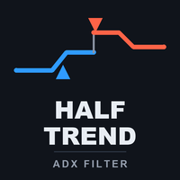

# Half Trend ADX (MetaTrader 5 and MetaTrader 4)

A trend indicator that draws a blue or red trend line with **buy and sell arrows where the trend turns**, sends alerts, and
can skip weak turns with an ADX filter. Arrows and alerts come from closed bars, so they do not repaint.

> **This is a showcase repository: documentation and images only. There is no source code here.** The product is sold on
> the MQL5 Market. It is an indicator, not a trading system: it places no orders and manages no trades.

**Website:** [allanninal.dev/mql5 (indicators)](https://www.allanninal.dev/mql5/#indicators) · [MT4 editions](https://www.allanninal.dev/mql5/#mt4) · [allanninal.dev](https://www.allanninal.dev)
· **Contact:** message me on [LinkedIn](https://www.linkedin.com/in/allanninal/).

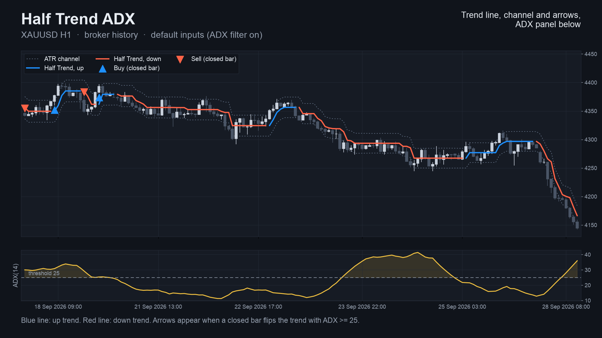

## Get it on the MQL5 Market

| Product | Platform | Price | Link |
|---|---|---|---|
| **Half Trend ADX** | MT5 | paid | <https://www.mql5.com/en/market/product/201564> |
| **Half Trend ADX MT4** | MT4 | paid | <https://www.mql5.com/en/market/product/202401> |

This product has no free sibling. Details, current price and the Strategy Tester demo (visual mode only) are on the Market
pages.

## What it does

- **A trend line:** blue while the trend is up, red while it is down.
- **One arrow per turn:** a buy arrow below the candle, a sell arrow above, on the bar where the trend turned.
- **An optional ADX filter** (on by default): a turn is marked only if ADX on that closed bar is strong enough. The line
  itself always follows the trend. Switch the filter off for an arrow on every turn.
- **An optional channel** of two dotted lines around the trend line.
- **Alerts:** pop-up (on by default), sound, push notification and e-mail, each switched separately. Nothing is sent while
  history loads, never twice for the same bar, and not in the Strategy Tester.
- **Closed bars only.** The forming bar never carries an arrow, and a closed bar's arrow never changes. The line and the
  channel can move on the forming bar.
- **Buffers for Expert Advisors** (line, colour, buy, sell, channel, ADX) are documented on the Market page.
- Works on any symbol and timeframe, including gold and crypto.

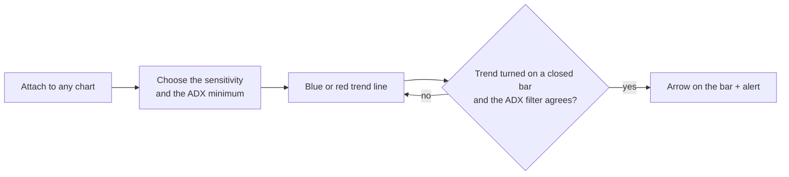

### What the trend can be

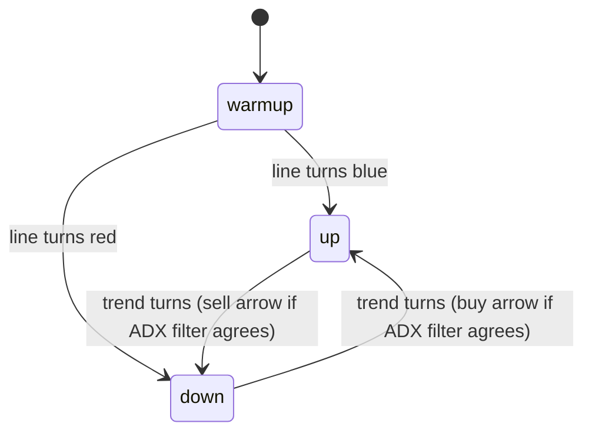

| | |
|---|---|
| 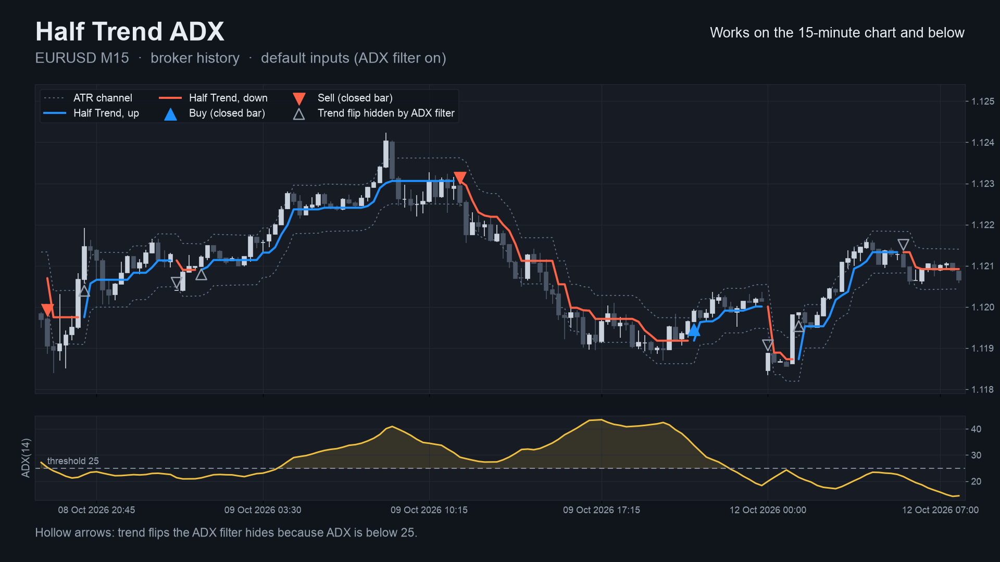 | 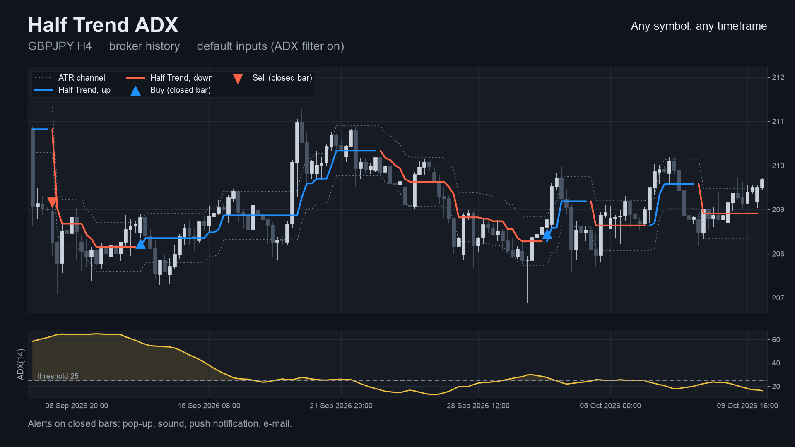 |
| 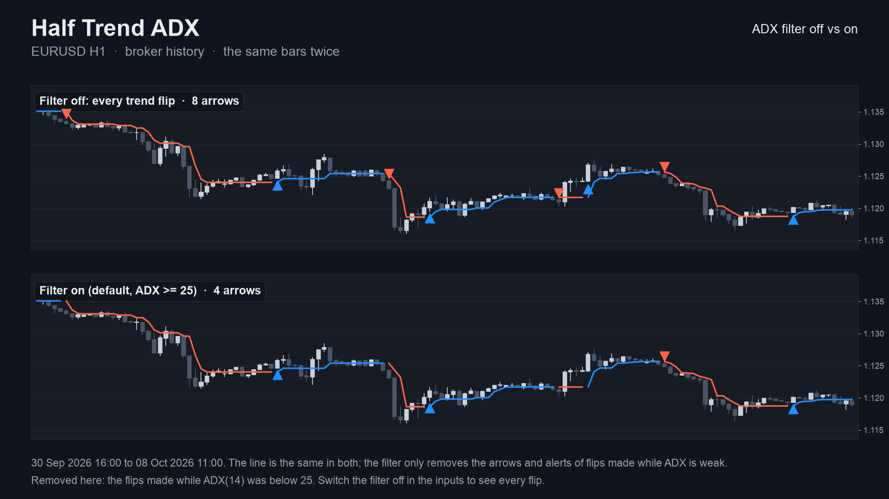 | 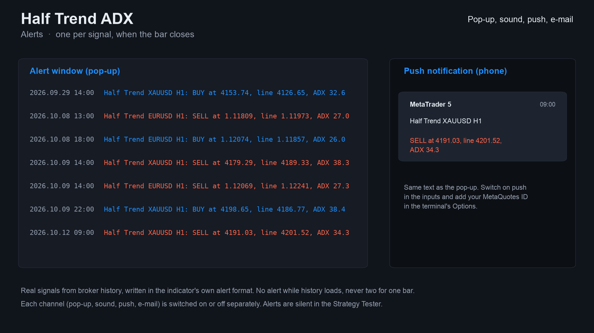 |

MT4 edition screenshots: [XAUUSD H1](images/mt4/01-xauusd-h1.png), [EURUSD M15](images/mt4/02-eurusd-m15.png).
Some screenshots are illustrations built from broker history, not terminal captures.

## Who it is for

Traders who read trend turns on the chart, or who build their own rules or Expert Advisor on an indicator. Not for anyone
looking for an automatic trading robot.

## Why it was built

- The Half Trend is a well-known TradingView indicator, and traders moving to MetaTrader ask for it.
- Our October 2026 market research found it requested only rarely by name (1 to 14 freelance requests for the classic named indicators we counted), so
  this is a niche product, not a claim of mass demand.
- Design rule: trust. Arrows are decided at bar close and never change afterwards.
- We looked for a setting that could be offered as "tested to work". None could: in our own walk-forward tests on crypto,
  the best Half Trend setting changed every year and lost in 2022 to 2023, and on one forex pair the result was negative.
  So the presets below are starting points that differ only in how many arrows they give, and no profit claim is made.

## Starting settings

Four starting points, from the listing. They differ in how many arrows they give, not in how well they trade; none is
optimised. Arrows per month are a code count on broker history, October 2023 to October 2026, EURUSD, GBPUSD, USDJPY and
XAUUSD, closed bars.

| Timeframe | Amplitude | Minimum ADX | Arrows per month |
|---|---|---|---|
| M15 | 3 | 30 | about 13 to 15 |
| H1 | 2 (default) | 25 (default) | about 10 |
| H4 | 2 | 20 | about 4 |
| D1 | 1 | 20 | about 1 |

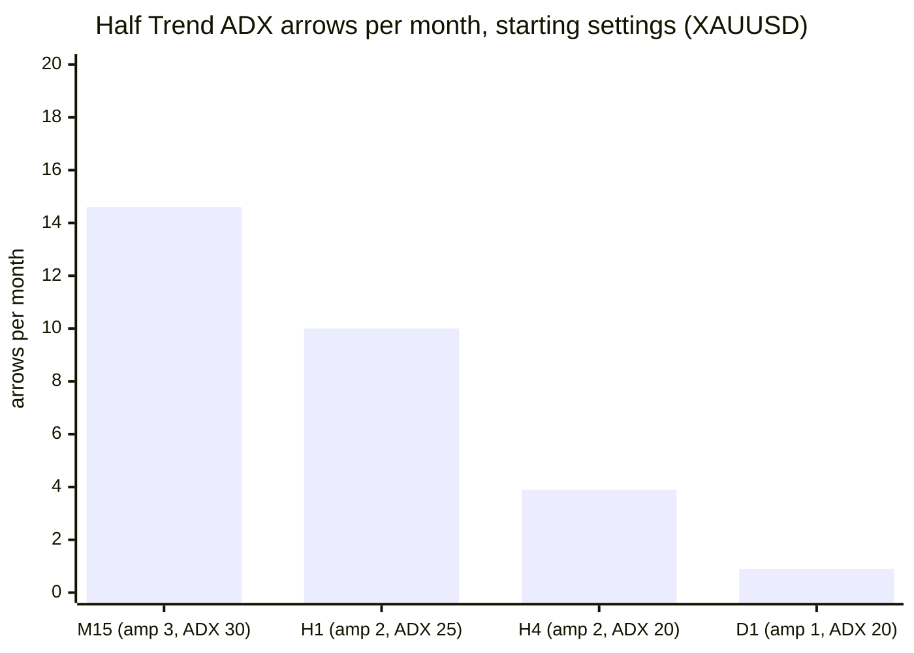

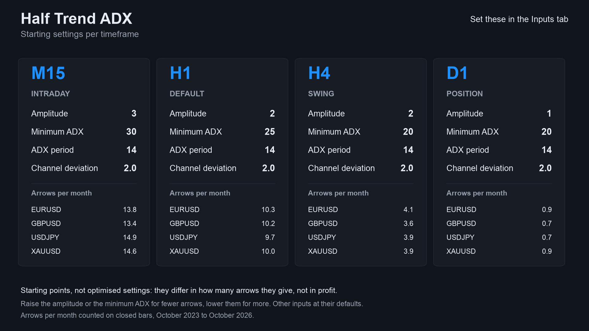

## How it was checked (results)

The indicator's line, channel, ADX and every arrow were compared bar by bar with an independent Python calculation in the
MetaTrader Strategy Tester (EURUSD, GBPJPY, XAUUSD and BTCUSD on M15, H1 and H4; three input sets).

| | MT5 | MT4 |
|---|---|---|
| Test files compared | 36, all pass | 37, all pass |
| Bars compared | 1,122,892 | 761,453 |
| Arrows compared (buy + sell) | 28,981 | 20,211 |
| Differences | 0 | 0 |

Repaint checks (the values of each signal buffer when its bar closed against the final values, plus any signal on the
forming bar):

| Run | Closed bars checked | Signals seen at close | Changed afterwards | Signals on the live bar |
|---|---|---|---|---|
| MT5, EURUSD H1, every tick (10,411,052 ticks) | 4,644 | 102 | **0** | **0** |
| MT4, 37 runs combined | 756,852 | 20,199 | **0** | **0** |

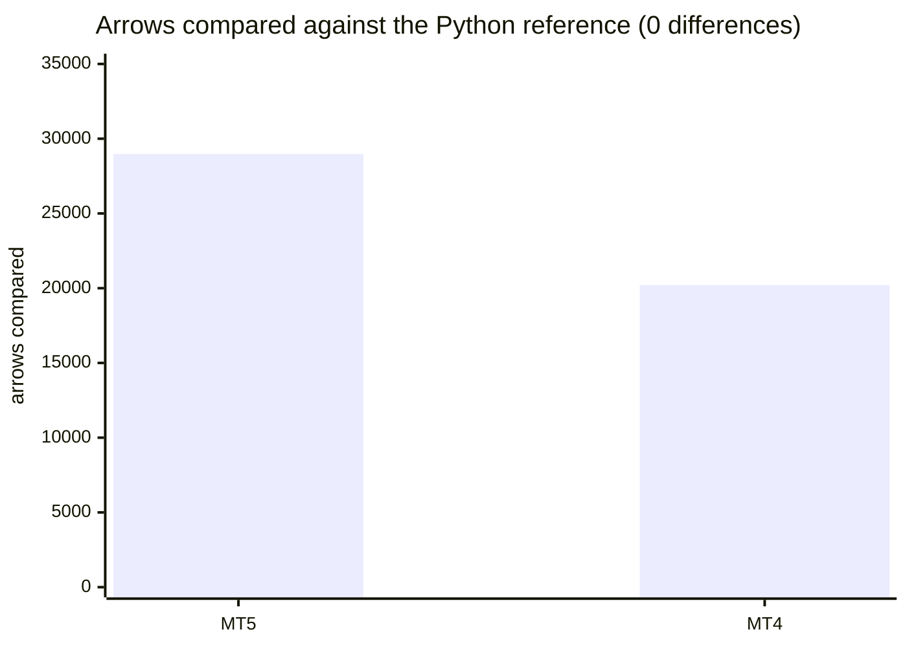

These are code checks: they show the indicator behaves as described, not that the arrows are profitable.

## Honest limits

- An indicator signal is not a strategy. No stop-loss, position sizing or exit rules are provided, and the arrows were not
  optimised or back-tested for profit. No profit or accuracy claim is made.
- A trend line confirms a turn after it has started; fewer arrows (a larger amplitude or ADX minimum) come later still.
- Sideways markets produce frequent turns. The ADX filter skips some, not all.
- The line and channel can move on the forming bar; only arrows and alerts are final.
- Tested on four symbols and three timeframes; other symbols and timeframes are not covered by the numbers above.
- The source is not published; this repository documents what the product does and the results of its checks.

## Credits

The half-trend idea is popularised by open-source TradingView scripts. This product is an independent implementation.

---

**Website:** [allanninal.dev/mql5](https://www.allanninal.dev/mql5/#indicators) · [MT4](https://www.allanninal.dev/mql5/#mt4) · [allanninal.dev](https://www.allanninal.dev)
· Questions: message me on [LinkedIn](https://www.linkedin.com/in/allanninal/). All rights reserved, see [LICENSE](LICENSE).
